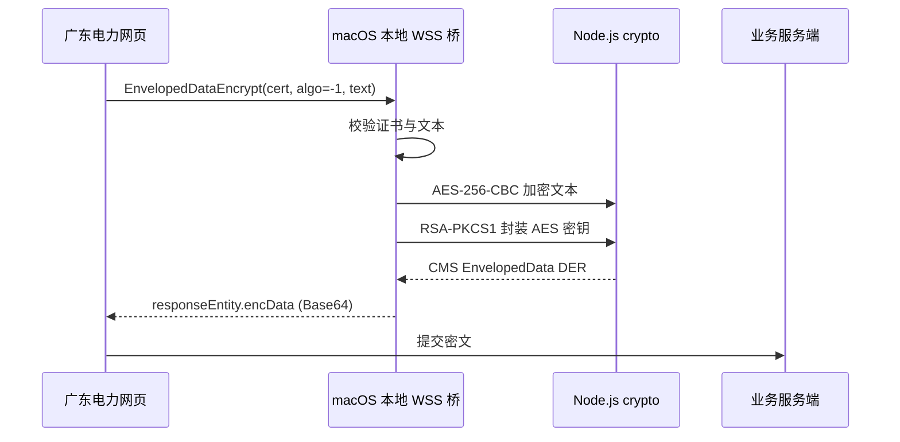

# 网证通数字信封 Apple 芯片 macOS 适配报告

> 分析日期：2026-09-07  
> 报告类型：普通兼容性逆向（flavor = null）  
> 工具链：innoextract 1.9.14、radare2 6.2.2、Node.js 24.17.0、LibreSSL 3.3.6、Apple clang/Swift
>
> 说明：文中指向 `../work/` 的取证链接是本地资料，该目录不纳入版本库（约 1.5 GB，见 [work/README.md](../../work/README.md)）。应用构建只依赖从中抽取并已提交的 `vendor/netca/netca-trust.sqlite`。

## 执行摘要

本次以用户持有的旧 Windows 网证通驱动为离线行为参考，为现有 Apple 芯片 macOS USBKey 助手补齐网站实际调用的 `EnvelopedDataEncrypt`。分析确认网证通在 `algo: -1` 时读取默认算法 6，即 AES-256-CBC；接收方会话密钥使用 RSA-PKCS#1 v1.5 封装。macOS 桥已实现对应 CMS EnvelopedData，并通过源代码单元测试、真实 WSS 信封测试和 OpenSSL 解密三层验证。版本 1.1.0 App 已运行，USBKey 仍可读取两张证书，安装包及校验文件已生成。生产页面的最终业务验证需要用户在专用网络中自行输入敏感密码后复测。

## 范围与授权

授权、目标、排除项及数据处理约束记录在 [case scope](../../work/gdpower-enveloped-adapter/scope.md)。Windows 二进制只做静态分析和解包，没有执行；网络操作仅限用户明确指定的网站及其静态 SDK 资源。

## 静态分析与实现结论

主安装包使用 Inno Setup。解包后的 `NETCA_CRYPTO.dll` 导出 `NetcaPKIAppEnvelopedDataEncrypt`、`NetcaPKIAppNewEnvelopedDataEncryptHandle`、`NetcaPKIMsgEnvelopedDataAddCert` 和 `NetcaPKIMsgEnvelopedDataEncrypt`。应用层调用顺序为创建数字信封句柄、写入默认配置、添加接收方证书、加密内容并返回 DER。

默认配置初始化函数在算法字段写入 `6`。算法到 OID 的映射函数将 `6` 映射为 `2.16.840.1.101.3.4.1.42`（AES-256-CBC）。因此 macOS 实现没有采用 LibreSSL CMS 的 RC2 默认值，而是明确构造以下结构：

- 内容算法：AES-256-CBC，随机 32 字节密钥、随机 16 字节 IV、PKCS#7 填充；
- 密钥算法：接收方 RSA 公钥与 PKCS#1 v1.5 padding；
- 接收方标识：证书 DER 中的 issuerAndSerialNumber；
- 外层格式：CMS ContentInfo / EnvelopedData，最后以 Base64 返回网页。

## Evidence → Finding → Path

| Evidence | 来源 | 可复现命令 | 哈希 |
|---|---|---|---|
| E-001 | NETCA_CRYPTO 导出与调用面 | `rabin2 -E .../NETCA_CRYPTO.dll` | `6cd3ee59...310a7d1` |
| E-002 | 默认值和算法 OID 映射反汇编 | `r2 -A ...; pdf` | `870ebe7e...f2fdfc` |
| E-003 | 本地 CMS 解析与解密测试 | `make test` | n/a（命令证据） |
| E-004 | 1.1.0 App 内置桥 WSS 测试 | 查看脱敏 bridge.log | n/a（日志证据） |

完整 Evidence 字段见 [case evidence](../../work/gdpower-enveloped-adapter/evidence/)，Finding 见 [findings.md](../../work/gdpower-enveloped-adapter/findings.md)。核心结论 F-001 与 F-002 均为 `validated`、`confidence: high`，分别由静态算法恢复和独立加解密验证支撑。

调用路径 P-001：网页参数校验 → `algo: -1` 解析为 AES-256-CBC → 随机会话密钥加密文本 → RSA 封装会话密钥 → CMS DER/Base64 → `responseEntity.encData`。完整步骤和残余风险见 [paths.md](../../work/gdpower-enveloped-adapter/paths.md)。

## 验证结果

`make test` 会生成临时 RSA 证书，调用与网页同形状的参数，检查 CMS 中的 `pkcs7-envelopedData`、`rsaEncryption` 和 `aes-256-cbc`，再使用对应测试私钥解密并逐字节比较 UTF-8 原文。相同测试已对桌面 1.1.0 App 内置的 WSS 桥执行，响应状态为 0，解密得到原文 `A1b2`。

USBKey 探测结果为 `device_found: true`、`read_sw: 9000`、`certificate_count: 2`。数字信封操作只使用网页传入的接收方公钥，不读取或导出 USBKey 私钥，也不需要记录业务密码。

## 交付物与使用

- App：[广东电力USBKey助手.app](../../build/release/广东电力USBKey助手.app)
- 安装包：[广东电力USBKey助手-1.1.0-apple-silicon.pkg](../../dist/广东电力USBKey助手-1.1.0-apple-silicon.pkg)
- 校验文件：[广东电力USBKey助手-1.1.0-apple-silicon.pkg.sha256](../../dist/广东电力USBKey助手-1.1.0-apple-silicon.pkg.sha256)
- 安装说明：[INSTALL_APPLE_SILICON.md](../INSTALL_APPLE_SILICON.md)

安装包 SHA-256 为 `6c5abae4ea7b91555bb472972196f0d64bcf991c1e69d56512edb00cdae01da8`。当前构建没有 Developer ID 和 Apple 公证，其他 Mac 首次安装时可能需要按安装说明在“隐私与安全性”中确认。

## 时间线与残余验证

关键阶段包括：授权范围建立、Inno payload 解包、NETCA 配置与算法映射恢复、CMS 实现与离线解密、Apple Silicon 打包及内置桥复测。完整记录见 [timeline.md](../../work/gdpower-enveloped-adapter/timeline.md)。

唯一未自动执行的步骤是生产业务控件提交：该步骤涉及用户密码和专用网络，必须由用户本人操作。桥已保留脱敏审计日志；复测时只需确认 `EnvelopedDataEncrypt` 的 `rpc_response.status` 为 0，以及页面不再出现“不支持”提示。
